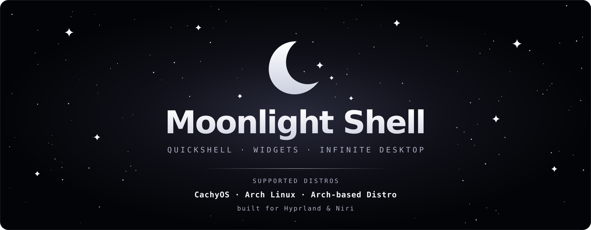
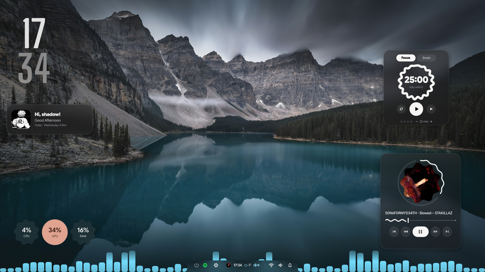
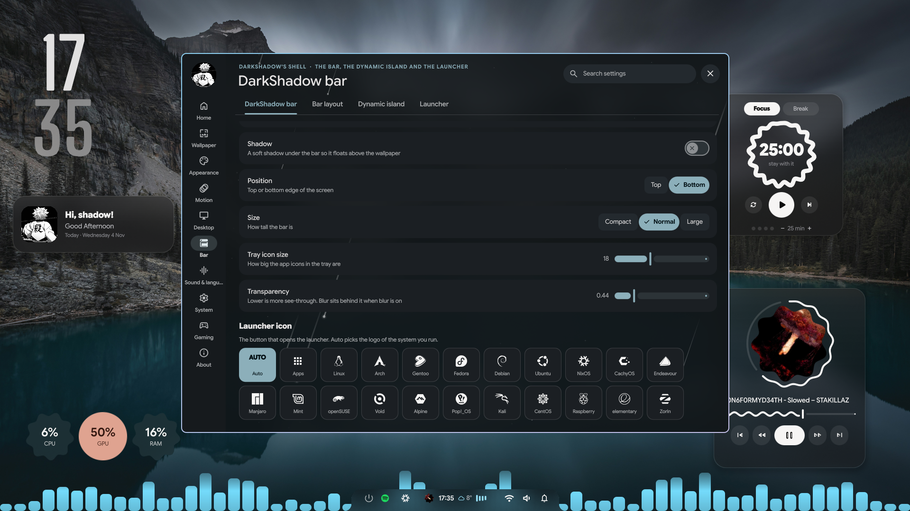
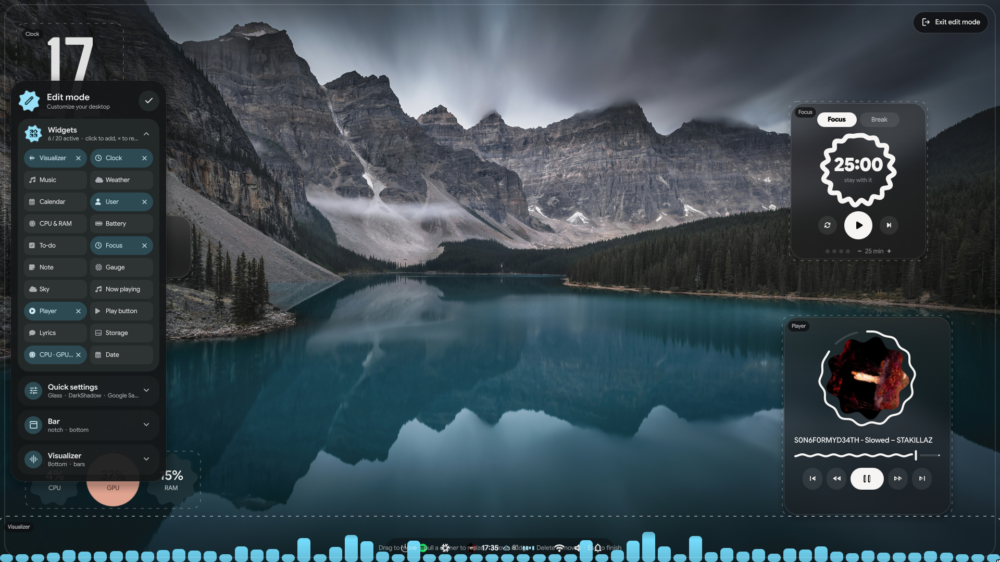

<p align="center">
  
</p>

<p align="center">
  <b>A Hyprland and niri rice with its own Quickshell settings app, bar, launcher, desktop widgets and a dock.</b><br>
  Everything is set with sliders and switches in one app. No config editing.<br>
  Made by <a href="https://www.tiktok.com/@shadoww.dev">shadoww.dev</a>
</p>

<p align="center">
  <a href="#supported-systems"></a>
  <a href="#supported-systems"></a>
  <a href="#supported-systems"></a>
  <a href="#supported-systems"></a>
</p>
<p align="center">
  
  
  
</p>
<p align="center">
  <a href="https://github.com/shadowww-dev/DarkShadowShell/releases/latest"></a>
  <a href="https://github.com/shadowww-dev/DarkShadowShell/stargazers"></a>
  <a href="https://github.com/shadowww-dev/DarkShadowShell/commits"></a>
  <a href="LICENSE"></a>
  <a href="https://www.tiktok.com/@shadoww.dev"></a>
</p>

<p align="center">
  <a href="#install-in-one-minute">Install</a> ·
  <a href="#supported-systems">Systems</a> ·
  <a href="#features">Features</a> ·
  <a href="#keybinds">Keybinds</a> ·
  <a href="docs/INSTALL.md">Docs</a> ·
  <a href="docs/CUSTOMIZE.md">Customize</a>
</p>

---

## Screenshots
<p align="center">
  <br>
  <sub>The desktop: widgets in your shape with wavy rings, the dynamic island in the notch and the visualizer</sub>
</p>
<p align="center">
  <br>
  <sub>The Settings app (<code>SUPER + U</code>)</sub>
</p>
<p align="center">
  <br>
  <sub>Edit mode (<code>SUPER + ALT + W</code>): widgets, quick settings, the bar and the visualizer</sub>
</p>
<!-- more screenshots: put the files in assets/ and add them here -->

## Supported systems
The bar, the welcome window and Settings show **your distro's logo** automatically.

| System | Status | How |
| --- | --- | --- |
| **NixOS** | main system | the module in `nix/`, then `./install.sh` |
| **Arch Linux** | supported | `./install.sh` |
| **CachyOS** | new in V2.70 | `./install.sh` (Arch based: its repositories and `paru` are used) |
| **EndeavourOS, Garuda** | Arch route | `./install.sh` |
| **Fedora, Nobara** | new in V2.60 | `./install.sh` (COPR for Hyprland and Quickshell) |
| **Bazzite, Silverblue** | commands only | the installer prints the `rpm-ostree` steps |
| **Manjaro** | may not work | its packages are held back, Hyprland can be older than 0.55 |

CachyOS and Fedora support is new: if something does not install, open an issue with the installer log and it gets fixed fast.

### Hyprland or niri
The shell runs on **Hyprland** and on **niri** (the scrollable-tiling window manager), on every system above. Hyprland is set up by default; `./install.sh --wm=niri` sets up niri, `--wm=both` both (then you pick one on the login screen).

On niri everything works the same: the bar, the island, workspaces, widgets, dock, launcher, lock screen, Settings and its sliders (gaps, borders, corners, shadows, blur, animation styles, keyboard, monitors, your keybinds and autostart). The shell writes `~/.config/niri/config.kdl` for you (`rice-niri`) and checks it with `niri validate`, so it fits your niri version; your own niri settings go in `~/.config/niri/user.kdl` and always win. Blur needs niri 26.04 or newer. niri extras: `SUPER + Tab` (or the top-left corner) shows the overview, `SUPER + Shift + /` lists every key, and windows sit in columns (`SUPER + R` changes the width, `SUPER + F` maximizes, `SUPER + [` / `]` takes a window in or out of a column).

## Install in one minute
Pick your system, paste the three lines, then log out, choose **Hyprland** or **niri** on the login screen and press `SUPER + U`.

**Arch Linux / CachyOS / EndeavourOS / Garuda**
```bash
sudo pacman -S --needed git base-devel
git clone https://github.com/shadowww-dev/DarkShadowShell shadows-shell && cd shadows-shell
./install.sh
```

**Fedora / Nobara**
```bash
sudo dnf install -y git
git clone https://github.com/shadowww-dev/DarkShadowShell shadows-shell && cd shadows-shell
./install.sh
```

**NixOS**
```bash
git clone https://github.com/shadowww-dev/DarkShadowShell shadows-shell && cd shadows-shell
# add to /etc/nixos/configuration.nix:
#   imports = [ /path/to/shadows-shell/nix/module.nix ];
#   programs.shadows-shell.user = "yourname";    # Infinite Desktop: SUPER + ALT + mouse (input group)
sudo nixos-rebuild switch && ./install.sh
```

The installer asks which window manager you want (Hyprland, niri or both), installs the packages, copies the configs and sets everything up. Every file it replaces is saved in `~/.config/darkshadows-shell-backup-<time>/`.
- **Arch:** no AUR helper needed. `paru` or `yay` are used when you have one; otherwise yay is set up only if your Arch lacks something the shell needs. The Bibata cursor comes from GitHub when there is no AUR helper.
- **Fedora:** COPR repositories give the newest Hyprland, Quickshell and awww; Atomic Fedora (Bazzite, Silverblue) gets the `rpm-ostree` commands instead.
- **NixOS:** the module turns on Hyprland and niri (`programs.niri.enable = false;` leaves niri out).

| Option | What it does |
| --- | --- |
| `--wm=hyprland` / `--wm=niri` / `--wm=both` | the window manager, without the question |
| `--yes` | everything, no questions |
| `--aur` / `--no-aur` | Arch: always get yay and every AUR package / never build yay |
| `--no-packages` | skip the package step |
| `--dry-run` | show what would happen, change nothing |
| `--restore` | put back the files from the last backup |

**Updating:** Settings > **Update Center** > Update now (the steps show live, no terminal), the update notification, or `rice-update` in a terminal.

## Features
**Settings app** (`SUPER+U`) in the spirit of Material 3: a navigation rail (Home, Wallpaper, Appearance, Motion, Desktop, Bar & island, Sound, System, Gaming, About) with tabs, Google icons, colors made from your theme and a search over every setting.

**Font**: the whole interface uses **Google Sans Flex** (and Google Sans Code for codes), both open source under the SIL Open Font License; the terminal keeps JetBrainsMono Nerd Font.

| Area | What you get |
| --- | --- |
| **DarkShadow bar** | the Quickshell bar: style Dynamic (the default: an island in the middle that is your clock and grows into the player, volume, workspaces, notifications, today and recording), Flat, Island, Islands, Pills or Notch, auto-hide, a soft shadow, position top, bottom, left or right (a standing bar), size, transparency, workspaces as dots, Pac-Man or letters, clock with seconds, a switch back to Waybar |
| **Bar styles** | Flat, Floating, Islands, **One island**; group styles None, Pills, Segmented |
| **Autohide** | bar slides in when the pointer touches the screen edge |
| **Distro logo** | the logo of your distro (NixOS, Arch, CachyOS, Fedora, Nobara, EndeavourOS ...) in the bar, the welcome window and Settings, picked automatically |
| **Desktop widgets** | frosted glass over your blurred wallpaper (or plain cards), auto-hide while windows are open; clock, calendar, weather, music, resources (CPU, RAM, GPU), user card, battery gauges in soft shapes (CPU, RAM, GPU, heat, battery), the date in a flower, and a see-through audio visualizer (Bars like cava in a terminal, Mirror, Wave, Dots, in your Theme color, a gradient or rainbow), a to-do list, a focus timer and a note; three widget styles (DarkShadow, Google, Outline); colors that turn light or dark with your wallpaper; Sky, Now playing, Player, Play button, Lyrics, Storage and CPU · GPU · RAM; Edit mode with a side panel for widgets, quick settings, the bar and the visualizer |
| **Today & System** | click the clock (or SUPER + ALT + D) and a Material 3 card grows out of the bar with today (calendar, weather, the day as a wave) and System (CPU, GPU and RAM in wavy rings, the disk); right-click for System. Settings > Dynamic island: weather and date beside the time, what it grows into (music, volume, workspaces, notifications, the charger), which tab a click opens and how fast the card closes |
| **Wallpaper picker** | SUPER + W: your wallpapers in a sheet with search, shuffle and keys; colors follow (a black, white or grey wallpaper gives grey colors) |
| **Wallpapers** | animations when one comes in (Ripple from your pointer, Wave, Wipe, Portal, Fade, Slide, Dissolve), a slideshow, **live wallpapers** (videos, with mpvpaper), your Waypaper folders, space wallpapers in the Material style |
| **Desktop menu** | right-click the desktop: your wallpapers in a row, quick switches (next wallpaper, night light, Do Not Disturb, gaming mode, lock) and the places you change most in Settings, in Material 3 with frosted glass |
| **Themes** | a whole look in one click (DarkShadow, Terminal, Glass, Neon, Ember, Frost), and your colors in VSCodium / VS Code and Discord (Vesktop, Vencord, Equicord, BetterDiscord) |
| **Monitors** | resolution, refresh rate, scale, rotation, arrangement and turning a screen off, on Hyprland and niri |
| **Bar layout** | five ready-made Material 3 layouts, and drag and drop the modules between left, center and right: launcher, workspaces, window title, music, the island (your clock), tray (right-click an app: its menu and Close app; long menus scroll), volume, Bluetooth, Wi-Fi, battery, notifications, power, a music visualizer; the window title with its app icon on the left or right |
| **Dock** | bottom, left or right edge, its own app menu with search, pinned favourite apps (also in Settings > Dock), open apps, hover to reveal, media player, tinted icons; windows keep away from it while it stays out |
| **Hyprland & niri** | gaps, borders, rounding, blur, shadows and animations from sliders, no config editing, on either window manager |
| **Theme** | 21 color schemes: Auto and Grey from your wallpaper, six monochrome (Mono, Slate, Stone, Steel, Ash, Ink) and thirteen colors (Navy, Ocean, Sky, Teal, Mint, Forest, Lime, Gold, Sunset, Ember, Rose, Orchid, Violet). They recolor Waybar, borders, notifications and the lock screen |
| **Control center** | `SUPER + N` or the bell: switches, sliders, music with a wavy, seekable progress line and your notifications, with smooth Material 3 motion |
| **Notifications** | shown by the shell in the Google style (or swaync, one click away): pop-ups with the app icon in your shape, pictures, action buttons and a line that shows how long they stay; position, width, time on screen, six themes, text size, corners, transparency and blur, live preview and a test button |
| **Sfx & sounds** | interface sounds in the shell's own parts (clicks, switches, sliders, typing), eight packs (Pebble, Tap, Soft, Pluck, Keys, Crystal, Bubble, Retro), volume, each sound on or off, quiet music for the welcome; ten notification sounds (Glass, Droplet, Chime, Bubble, Marimba, Aurora, Ping, Harp, Keys, Ripple) or Off |
| **Search** | "Search anything!" in Settings finds every setting ("bar position", "blur", "clock font") and jumps to it |
| **Updates** | a notification when a new version is out ("Update is Available!"), the **Update Center** in Settings (Update now, every step live, no terminal), `rice-update` in a terminal |
| **Idle & Lockscreen** | lock, screen-off and sleep timers; the shell's own Material 3 lock screen: your wallpaper (or the screen) blurred, the clock big, stacked, minimal or inside your shape, a greeting with your picture in your shape, chips for weather, battery, notifications, CPU and RAM (wavy rings), the music with a wavy line, the password as shapes, power buttons (Shut down in red), a Preview button; hyprlock is the fallback and still one switch away |
| **Launcher** | the built-in DarkShadow Launcher: 5 themes (Shadow, Graphite, Midnight, Rose, Paper), layouts list / grid / full-width bar / split (wallpaper on the left), position top, center or bottom, width, rows, corner radius, transparency, blur, font size, icons |
| **Cursors** | Bibata, Hyprcursor themes (Rose Pine) and packs you can download in Settings: Catppuccin, Phinger; live preview |
| **Appearance** | Colors (every color role of your theme), Fonts (typography: text size, heavier headings, rounded letters, the Material 3 type scale), Components (switch icons, corner shape, slider thickness, wavy progress) |
| **Motion** | Hyprland animation styles (calm, lively, bouncy, snappy, minimal) and speed, spring and easing graphs, durations, a shape you can throw |
| **Keyboard** | up to four layouts, the one in use, the keys that switch them, search over every layout |
| **Game bar** | `SUPER + G`: CPU and GPU with their heat, RAM, ping, screenshot, record, microphone, power mode, gaming mode, Do Not Disturb, volume and brightness over your game; its transparency and blur in Settings > Gaming |
| **Welcome intro** | once after installing: night falls over the desktop, a few words, the black hole logo draws itself in, "Take a look" opens it up again and Settings starts a short tour (it lights up one part at a time). Play it again with `rice-welcome show`, only the tour: `rice-welcome tour` |
| **Performance & gaming** | one switch turns off all blur and transparency (Hyprland, kitty, bar, launcher, notifications, dock, widgets); Gaming mode with options to keep blur, animations, shadows or gaps, Do Not Disturb (Settings > Services) |
| **Your settings everywhere** | `./sync.sh` saves your Settings choices to `settings/`, `./install.sh` puts them on your other computers (files you changed there are kept) |
| **Languages** | English and Polish (Settings and the desktop) |
| **Installer** | interactive (Install, Update, Choose, Restore), backs up everything, supports Arch, CachyOS, Fedora and NixOS, warns when Hyprland is too old; a wallpaper is put on right after installing |

## Keybinds
`SUPER` is the main modifier. On niri the same keys work (the shell's own ones are identical), with niri's column keys in place of the Hyprland layout keys; `SUPER + Shift + /` shows them all there.

| Keys | Action |
| --- | --- |
| `SUPER + U` | open **Settings** |
| `SUPER + Q` | terminal |
| `SUPER + E` | file manager |
| `SUPER + R` | app menu |
| `ALT + Space` | app launcher (DarkShadow Launcher) |
| `SUPER + C` | close window |
| `SUPER + V` | toggle floating |
| `SUPER + P` | pseudo-tile |
| `SUPER + J` | toggle split direction |
| `SUPER + M` | exit Hyprland |
| `SUPER + ←/→/↑/↓` | move focus |
| `SUPER + 1 … 0` | go to workspace |
| `SUPER + SHIFT + 1 … 0` | move window to workspace |
| `SUPER + S` | show/hide scratchpad |
| `SUPER + SHIFT + S` | move window to scratchpad |
| `SUPER + scroll` | next/previous workspace |
| `SUPER + left mouse` | drag window |
| `SUPER + right mouse` | resize window |
| `ALT + ]` / `ALT + [` | volume up / down |
| `SUPER + F12` / `F11` / `F10` | volume up / down / mute (with on-screen display) |
| media keys | play/pause, next, previous |
| `Fn` volume / brightness keys, headset `+` `-` | volume, mute, microphone, brightness |
| `Print` / `SHIFT + Print` | screenshot of a region / the whole screen |
| `SUPER + SHIFT + R` | record a region (press again to stop) |
| `SUPER + A` | control center (quick switches) |
| `SUPER + G` | game bar |
| `SUPER + N` | control center (notifications) |
| `SUPER + ALT + W` | edit desktop widgets (add, move, resize, style) |
| `SUPER + ALT + D` | today & system card from the bar's island |
| `SUPER + W` | wallpaper picker |

## Layout
| Path | Contents |
| --- | --- |
| `bin/` | helper scripts installed to `~/.local/bin` |
| `quickshell/` | Settings app (`rice-settings`) and widgets/dock (`rice-desktop`) |
| `config/` | dotfiles installed to `~/.config` (Hyprland, Waybar, ...); the niri config is written by `bin/rice-niri` |
| `install/` | installer UI and distro detection |
| `lua/` | Hyprland add-ons: keybinds, widgets autostart |
| `wallpapers/` | original wallpapers, copied to `~/Pictures/Wallpapers` |
| `sounds/` | notification sounds (made by `install/tools/make-sounds.py`, CC0) |
| `VERSION` | the current version, used by the update check |
| `nix/`, `flake.nix` | NixOS module |
| `.github/` | CI (shellcheck, dry-run install) and issue template |

## Maintainers
`./sync.sh` copies your current setup from this machine into the repo (paths become `@HOME@`, no username is stored) and scans for secrets. Your choices in Settings go to `settings/`; `./install.sh` applies them on other computers, keeps files you changed there, and `./install.sh --update --use-saved-settings` takes the saved ones anyway.

To release a new version, put the new number in `VERSION` (for example `2.03`) and push. Everyone gets the update notification within a few hours.

## Thanks
**Sarods2D** ([sarodscommits](https://github.com/sarodscommits)): a big part of this shell stands on his work, and it should have said so from the start.
- **Infinite Desktop** comes from his [hyprland-infinite-desktop-v2](https://github.com/sarodscommits/hyprland-infinitie-desktop-v2) (MIT): the endless canvas of floating windows, moving it with the mouse and going from window to window. Our version is written again for this shell, but the idea and the way it works are his.
- The redesign of Settings and the shell in V3.23 was inspired by his **Iridium** shell.

Thank you for the time and work you put into them. Please check out and star his projects.

The idea of the Dynamic bar's island, a clock that grows into the player, notifications and more, comes from [hyprdots](https://github.com/fedyaqq34356/hyprdots) by fedyaqq34356. The island here is written from scratch.

## License
MIT, see `LICENSE`.
